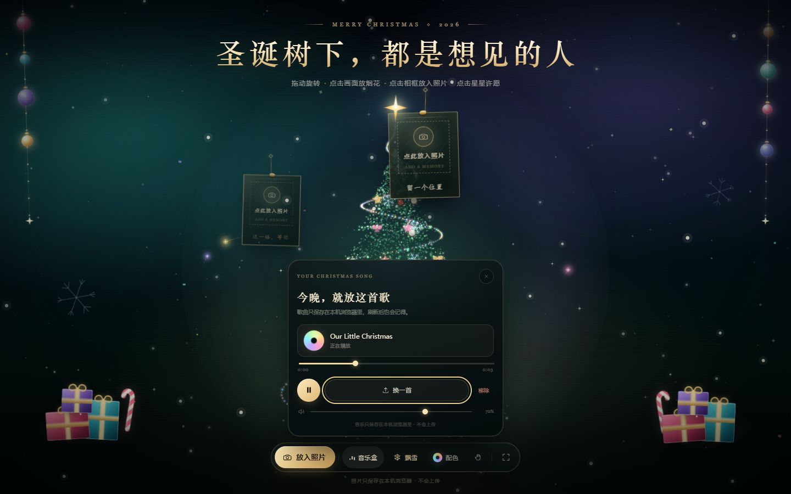

# 圣诞树下，都是想见的人

一棵可以放入自己照片、放上自己歌曲，还能**隔空用手势控制**的互动圣诞树。主页面仍然是单文件；本地/离线模式带一套完整的 MediaPipe 模型，托管网页则优先从国内镜像加载模型来加速。

这一版给树身挂上了会发光的**星星、雪花和蝴蝶结**，灯串更密、颜色更多；树身粒子加密到桌面约 5,500、手机约 4,200，炸开时再补上一层全屏星尘，整个画面都会被粒子铺满。两侧有会轻轻摇摆的彩球串、旋转雪花、礼物堆和拐杖糖，树身周围有彩色星轨和纸屑。音乐盒改成了**上传本地音乐**，手势模式则把“张开手掌 / 握拳 / 捏合”变成了树的动作。


## 怎么打开

- **普通模式**：直接双击 `index.html`，或双击 `打开圣诞树.bat`。
- **手势模式**：双击 `启动手势模式.bat`。它会打开一个黑色命令行窗口，并通常在浏览器里打开 `http://127.0.0.1:8791/`（端口被占用时会自动换一个）。
  - 使用摄像头时请**保持这个黑色窗口开着**，关闭窗口即停止本地服务器。
  - 不要用 `index.html` 的文件路径直接开手势模式；浏览器会拦截摄像头页面所需的模块加载。
  - 托管网页第一次加载手势模型需要下载约 17MB；面板里会显示下载进度，完成后会缓存到 IndexedDB，下次再开会快很多。
  - 也可以自己用 `python -m http.server 8791` 之类的本地服务器打开这个文件夹，再点底部的手形按钮。

推荐用最新版 Chrome / Edge 打开。微信内置浏览器可能会限制本地照片选择、摄像头和声音，建议点右上角「在浏览器中打开」。

## 怎么发给别人

### 最省心：发一个网址

这是纯静态页面，不需要后台。把**整个项目文件夹**（至少要有 `index.html` 和 `assets/gesture/`）放到支持 HTTPS 的静态托管上，把网址发出去即可：

- **Netlify Drop**：登录后打开 [app.netlify.com/drop](https://app.netlify.com/drop)，把整个 `shengdanshu` 文件夹拖进去，等它生成一个 `https://...` 地址。
- **GitHub Pages**：新建一个仓库，把 `index.html`、`assets/`、`preview/` 等文件按原目录结构上传；在 **Settings → Pages** 里选择 `main` 分支和根目录，保存后得到 `https://用户名.github.io/仓库名/`。
- **Cloudflare Pages / Vercel** 也可以，做法类似：上传静态文件，不需要构建命令。

网址是 HTTPS 时，朋友在手机或电脑上打开，点底部手形按钮、允许摄像头，就能隔空控制。**微信里打开如果摄像头没反应，让对方点右上角「在浏览器中打开」**。

### 发文件

发送完整 [圣诞树.zip](圣诞树.zip)（约 18MB），不要只发 `index.html`：手势识别模型在 `assets/gesture/` 里，少了它只能鼠标/触屏，不能隔空控制。

- **Windows**：对方解压后双击 `启动手势模式.bat`，保持黑色窗口开着，浏览器里允许摄像头即可。
- **Mac**：解压后在文件夹里运行 `python3 -m http.server 8791`，再打开 `http://localhost:8791/`。
- **手机**：手机不能自己运行本地服务器，建议用上面的网址方式；如果只发文件，鼠标/触屏、照片、音乐仍能用，但手势需要 HTTPS 页面。

### 他们会看到你的照片和音乐吗

不会。照片、音乐、愿望都只存在**每个人自己的浏览器**里，不会跟着文件或网址一起发送；朋友打开是一棵干净的树，需要自己放照片和音乐。如果你想让所有人都看到你选好的照片，需要另外做一个“内置照片版”。

## 可以怎么玩

- **放一场烟花**：点击/轻点画面空白处，会从指尖炸开一簇彩色烟花；烟花颜色会跟着当前光色变化。隔一会儿还会自动放一朵小小的氛围烟花。
- **换一种圣诞光**：点底部「配色」，可以在「极光 / 彩虹 / 糖果 / 鎏金」四套光色之间切换。主题会记住，下次打开还是它。
  - **极光**：青绿、粉紫和金色交织，清冷又梦幻。
  - **彩虹**：从树底的红橙到树顶的蓝紫，整棵树是渐变的彩虹。
  - **糖果**：粉、紫、薄荷和奶油色，软乎乎的甜。
  - **鎏金**：暖金、琥珀和珍珠白，最接近经典圣诞。
- **放入照片**：点击底部「放入照片」，最多放 6 张；也可以直接点树上的空相框，把照片挂到那一格。
- **看看照片**：点击任意相框，会放大照片；可以写一句照片背后的故事，也可以换一张或移除。
- **旋转圣诞树**：在画面空白处按住拖动，松手后会有惯性；不拖动时树会慢慢自转。
- **隔空手势**：点底部的**手形按钮**，再点「开启手势」，允许摄像头后：
  - **✋ 张开手掌**：整棵树炸开，树粒子会铺满整个屏幕，外加一层只在爆炸时出现的全屏星尘和冲击波；手掌左右移动还能带星云转。
  - **✊ 握紧拳头**：星云重新聚回圣诞树。
  - **🤏 拇指和食指捏合**：随机打开一张你放进去的照片。
  - 想停止时，再点手形按钮，点「停止手势」。摄像头开启期间，手形按钮上会亮一个绿色小点。
  - 手势识别对光线和距离比较敏感：让手掌正对镜头、离摄像头大约 40–80cm、光线亮一点，会稳很多。
- **没有摄像头也能玩**：按 **S** 散开 / 聚拢，按 **P** 随机看一张照片，按 **H** 隐藏底部工具栏和标题，方便截图或录屏。
- **许一个愿**：点击树顶的星星，写下愿望。愿望会留在这台设备里。
- **放上自己的音乐**：点底部「音乐盒」，选择一首本机音频（MP3 / WAV / OGG / M4A，最大 25MB）。上传后会自动播放，可以暂停、拖动进度、调音量、换歌或移除。歌曲会保存在浏览器的 IndexedDB 里，刷新后仍然在，但不会自动播放。
- **树上新挂饰**：星星会轻轻摆动，雪花会慢慢旋转，蝴蝶结会跟着树一起晃动；紫、蓝、粉、金、青色的灯串比以前更密，树身粒子比上一版多了一倍多。
- **飘雪 / 全屏**：底部两个按钮，可以随时开关雪，或进入全屏。
- **两侧的小装饰**：左右悬挂的彩球会摆动、雪花会慢慢旋转、礼物堆会轻轻上下浮动；礼物旁还有拐杖糖和闪烁的小星点。树身边会有彩色星轨绕着飞，雪里还会落下彩色纸屑。它们都不会挡住点击，点礼物附近一样可以放烟花。

<details>
<summary>看看四套光色、烟花、手势和音乐盒</summary>




</details>

## 手势交互是怎么实现的

整条链路都在浏览器本地完成，没有把摄像头画面上传：

1. **取画面**：点击「开启手势」后，用 `getUserMedia()` 把摄像头接进一个隐藏的 `<video>`，并请求 640×480 的视频流。
2. **取手部关键点**：用 MediaPipe **Hand Landmarker** 对每一帧做推理，拿到一只手 21 个关键点的坐标。离线模式直接使用 `assets/gesture/` 里的模型和 WASM；托管网页会优先从 `npmmirror` / `ghfast` 镜像加速加载，失败时回退到同目录下的本地资源。
3. **识别手势**：用关键点算手指伸展数量和拇指—食指距离，分成三类：
   - 四根手指都伸展 → 张开手掌；
   - 一根或更少手指伸展 → 握拳；
   - 拇指尖和食指尖距离小于阈值 → 捏合。
4. **映射到动作**：张开手掌把 `state.scatterTarget` 设为 1，握拳设为 0；每个树粒子都有自己预先算好的“散开目标点”，主循环用缓动在树形和星云之间插值。炸开时还会额外绘制一层只在此时可见的全屏星尘，再叠一圈向外扩张的冲击波，保证边缘和四角也有粒子。捏合则直接调用随机照片的打开逻辑。
5. **连续控制**：在星云状态里，手掌的横向位移会叠加到 `state.rotation`，所以挥手能让星云跟着转；摄像头关闭、页面切到后台或停止手势时，会主动停掉视频轨道并把树聚回来。

我参考了这类手势圣诞树开源项目的交互设计，但代码是重新接到这棵 Canvas 2D 粒子树上的：

- [ymqf/tree](https://github.com/ymqf/tree) — 原作者项目，张开手掌散开、握拳聚拢、捏合照片。
- [electronicminer/gesture-Christmas_tree-3d_with_photo](https://github.com/electronicminer/gesture-Christmas_tree-3d_with_photo) — Three.js + MediaPipe 的手势实现和说明。
- [MediaPipe Hand Landmarker](https://ai.google.dev/edge/mediapipe/solutions/vision/hand_landmarker) — 手部关键点模型与 API。

MediaPipe 运行时、WASM 和手部模型遵循 Apache-2.0，来源与文件说明见 `assets/gesture/README.txt`。

## GitHub 仓库和完整下载

GitHub 主仓库为了避开单文件上传限制，只放网页、预览图和小的运行时代码，**没有直接提交 17MB 的模型 + WASM**。托管在 GitHub Pages 时，页面会自动从 `npmmirror` / `ghfast` 镜像加载它们，功能是完整的。

如果要在本地 clone 后**完全离线**运行：

- Windows：在仓库根目录运行 `powershell -ExecutionPolicy Bypass -File scripts/fetch-models.ps1`
- macOS / Linux：运行 `bash scripts/fetch-models.sh`

脚本会下载并校验 `hand_landmarker.task` 和 `vision_wasm_internal.wasm`。补齐后按普通手势模式启动即可。仓库的 Release 里也会提供包含完整模型的 `圣诞树.zip`。

## 照片、音乐和隐私

- 所有照片只保存在**本机浏览器的 localStorage** 里，音乐保存在浏览器的 IndexedDB 里，都不会上传到任何服务器。
- 手势模式的摄像头画面只在浏览器本地交给 MediaPipe 推理，**不录制、不保存、不上传**；关闭手势或切到后台就会停掉摄像头轨道。
- 本地/离线模式不会向外部模型服务发请求；托管网页会从国内镜像下载公开的 MediaPipe 模型文件，但摄像头画面仍然只在本地推理，不会上传。普通模式双击 `index.html` 即可离线使用。
- 照片会自动压缩到最长边 900px，尽量节省浏览器空间；格式支持 JPG、PNG、WebP 等常见图片。
- 音乐大小限制 25MB；能不能播放取决于浏览器对音频编码的支持，常见 MP3 / WAV / M4A 最稳。
- 清除浏览器网站数据、换浏览器、换电脑，或把 `index.html` 移到别的路径后，已保存的照片、愿望、光色和音乐可能会消失。
- 分享给朋友时，对方打开的是干净的圣诞树，需要放对方自己的照片和音乐；照片、歌曲和摄像头画面不会跟着文件一起发出去。手势模式需要连同 `assets/gesture/` 和 `启动手势模式.bat` 一起分享。

如果双击打开后发现刷新会丢照片，可以用 `启动手势模式.bat` 打开本地服务器再访问；普通模式直接双击 `index.html` 也能正常保存照片。

## 想改成自己的版本

主要界面和逻辑都在 `index.html` 里；手势模型和 WASM 在 `assets/gesture/`：

| 想改什么 | 在哪里找 |
| --- | --- |
| 主标题、副标题 | HTML 里的 `.hero`；`h1` 和 `.hero__sub` |
| 年份 | 搜索 `id="yearLabel"`，现在会自动显示当前年份 |
| 最多放几张照片 | JS 开头的 `const PHOTO_LIMIT = 6;` |
| 相框大小 | CSS 的 `--photo-w` |
| 相框悬挂位置 | JS 里的 `SLOT_DEFS`（宽屏）和 `MOBILE_SLOTS`（窄屏） |
| 照片默认文案 | 搜索 `caption: '圣诞快乐'` |
| 四套光色的灯色、彩球、烟花配色 | JS 里的 `const THEMES` |
| 背景的四色光晕 | CSS 里的 `.theme-wash--aurora / prism / candy / gold` |
| 烟花数量、大小、持续时间 | JS 里的 `launchFirework()` |
| 两侧的礼物、彩球串、雪花 | HTML 里的 `.scene-decor` 和 CSS 的 `.gift-pile / .side-garland / .snow-charm` |
| 绕树飞行的彩色星轨 | JS 的 `buildSky()` 和 `drawSky()` 里的 `orbiters` |
| 彩色纸屑 | JS 的 `buildSnow()` 和 `drawSnow()` 里的 `confetti` |
| 树上的星星、雪花、蝴蝶结 | JS 的 `buildTree()` 里的 `specials` 和 `drawTree()`；精灵图在 `makeStarOrnamentSprite()` 等函数里 |
| 自转速度 | JS 主循环里的 `const auto = ...` |
| 音乐盒文案、大小限制 | HTML 的 `.music-tray`，以及 JS 的 `loadSongFile()` |
| 音乐存储 | JS 的 `MEDIA_DB_NAME` / `saveSongToDB()`（IndexedDB） |
| 手势面板文案、图标 | HTML 的 `.gesture-tray` 和 CSS 的 `.gesture-*` |
| 手势识别阈值 | JS 的 `classifyHand()`（手指伸展、捏合距离） |
| 手势动作映射 | JS 的 `handleGestureResult()` / `setScatterTarget()` |
| 手势模型与 WASM | `assets/gesture/`，以及 JS 的 `loadHandModel()` |

改照片上限时，记得同时准备对应数量的相框位置；`SLOT_DEFS` 和 `MOBILE_SLOTS` 默认各有 6 个位置。

## 兼容性

- 需要支持 Canvas 2D、Pointer Events、HTMLAudioElement 和 IndexedDB 的现代浏览器；手势模式还需要 WASM SIMD、摄像头和 `getUserMedia`。
- 手势模式推荐最新版 Chrome / Edge，并通过 `启动手势模式.bat` 的 `localhost` 页面打开；直接双击 `index.html` 时，普通照片、音乐和烟花功能不受影响，但摄像头模块可能被文件协议拦截。
- 音乐能否播放取决于浏览器对音频编码的支持；MP3 / WAV 兼容性最好。
- 开启「减少动态效果」的系统，会自动放慢自转、关闭部分装饰动画，并关闭自动氛围烟花；点击画面仍然可以自己放烟花。
- 手机端为了看清照片，会把相框固定在树的两侧；宽屏上相框会绕着树缓缓转动。
- 宽屏会显示两侧悬挂的彩球串和雪花；手机端会自动收起这两组装饰，保留礼物堆、星轨和纸屑，避免画面太挤。
- 在很窄的手机上，底部会收掉「音乐盒 / 飘雪 / 配色」的文字标签，只留图标和主要的「放入照片」，避免工具栏过宽。手势按钮始终保留。

## 文件

```
index.html             页面本体（图片、样式、脚本都在这一个文件里）
打开圣诞树.bat         普通模式：双击用默认浏览器打开
启动手势模式.bat       手势模式：启动本地服务器并打开摄像头页面
serve.ps1              启动手势模式用的零依赖本地静态服务器
scripts/               下载完整手势模型的辅助脚本
assets/gesture/        手势识别模型 + MediaPipe WASM（大约 17MB）
preview/               预览图
README.md              这份说明
```

`启动手势模式.bat` 只是把当前文件夹通过 `127.0.0.1` 提供出来，不会安装任何东西；用完后关闭黑色窗口即可。若端口被占用，会自动尝试 8791–8805。

圣诞快乐。愿你想见的人，都在身边，愿今年的圣诞比烟花更亮。
